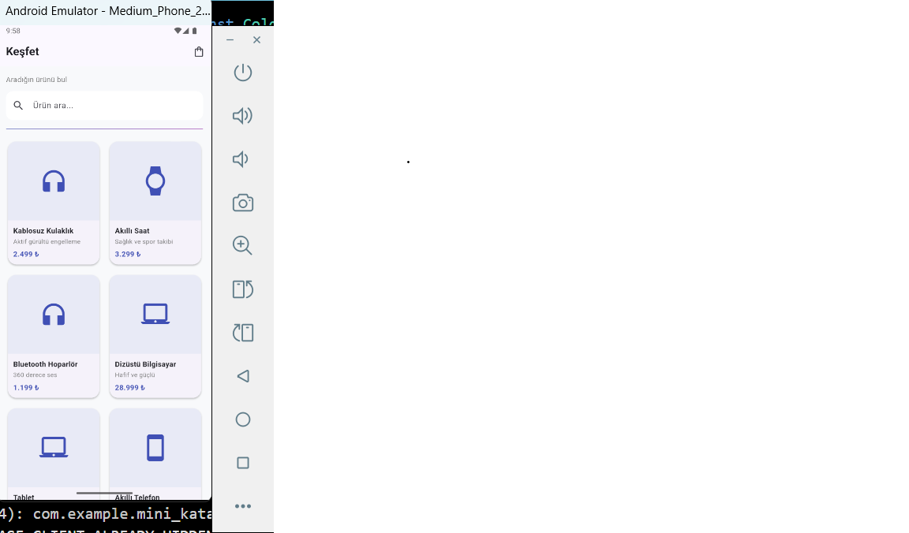
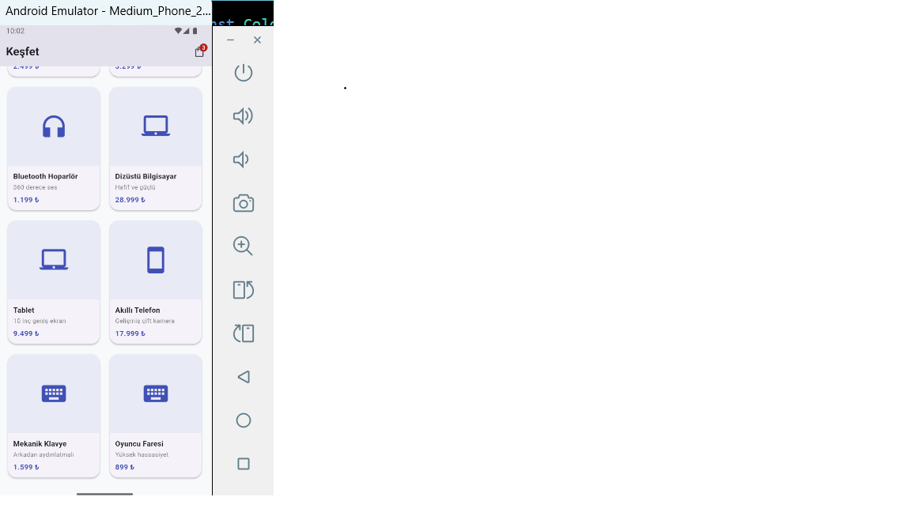
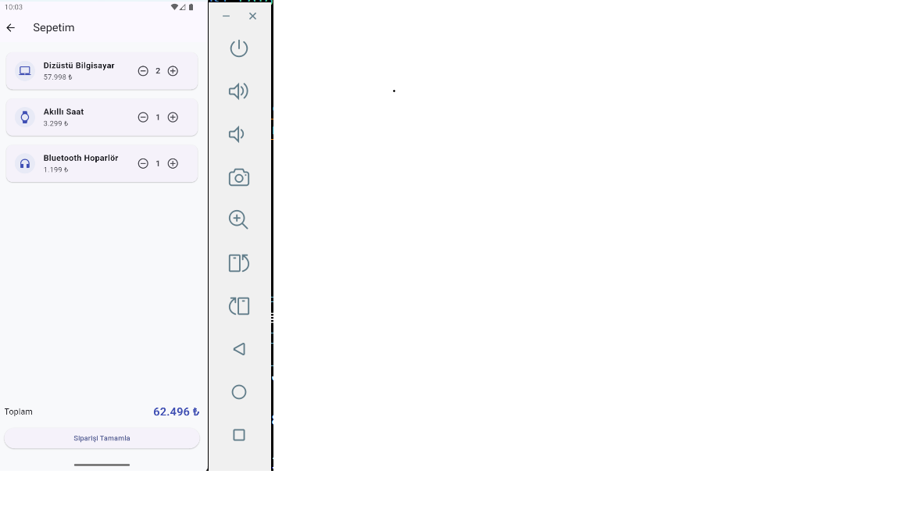

# Mini Katalog

Flutter ile geliştirilmiş basit bir mobil ürün katalog uygulamasıdır. Flutter eğitimi bitirme projesi olarak hazırlanmıştır.

**Geliştirici:** Tuğçe Akyıldız

## Kısa Açıklama

Uygulama; ürünleri bir ana sayfada kart yapısıyla listeler, bir ürüne dokunulunca ürün detayını gösterir ve ürünleri sepete eklemeye olanak tanır. Ürün verileri uygulamanın içindeki bir JSON dosyasından okunur (simülasyon), bu yüzden internet bağlantısı gerekmez. Ekstra paket kullanılmamıştır, yalnızca Flutter'ın `material.dart` paketi kullanılmıştır.

## Özellikler

- Ana sayfa: arama kutusu, banner ve 2 sütunlu `GridView` ile ürün kartları
- Ürün arama ve filtreleme (ürün adı ve kategoriye göre)
- Ürün detay sayfası (açıklama ve özellikler)
- Sayfa geçişleri: `Navigator.pushNamed` ve Named Routes
- Sayfalar arası veri taşıma: Route Arguments
- Sepet: ürün ekleme, adet artırma/azaltma, toplam tutar (state güncelleme)
- JSON'dan veri okuma: model sınıfı, `fromJson` / `toJson`
- Asset yönetimi: `assets/data/products.json`

## Kullanılan Sürüm

- Flutter 3.41.4 (stable)

Sürümünüzü kontrol etmek için: `flutter --version`

## Çalıştırma Adımları

1. Flutter SDK, Android Studio ve bir Android emülatörü (ya da USB ile bağlı Android telefon) kurulu olmalıdır.

2. Projeyi indirin:

```
git clone https://github.com/tugceakyildiz41/mini_katalog.git
```

3. Proje klasörüne girin:

```
cd mini_katalog
```

4. Paketleri yükleyin:

```
flutter pub get
```

5. Emülatörü başlatın ya da telefonu bağlayın. Cihazın görünüp görünmediğini kontrol edin:

```
flutter devices
```

6. Uygulamayı çalıştırın:

```
flutter run
```

VS Code kullanıyorsanız `lib/main.dart` dosyasını açıp `F5` tuşuna basmanız yeterlidir.

## Proje Yapısı

```
mini_katalog/
├── assets/
│   └── data/
│       └── products.json
├── lib/
│   ├── data/
│   │   └── product_repository.dart
│   ├── models/
│   │   ├── product.dart
│   │   └── cart_model.dart
│   ├── screens/
│   │   ├── home_screen.dart
│   │   ├── detail_screen.dart
│   │   └── cart_screen.dart
│   ├── utils/
│   │   └── helpers.dart
│   ├── widgets/
│   │   └── product_card.dart
│   └── main.dart
├── screenshots/
├── pubspec.yaml
└── README.md
```

## Ekran Görüntüleri

| Ana Sayfa | Ürün Listesi |
|---|---|
|  |  |

| Ürün Detayı | Sepet |
|---|---|
|  |  |

## Not

Ürün verileri ve sepet eğitim amaçlı simülasyondur. Gerçek bir ödeme ya da sunucu bağlantısı yoktur. Sepet, uygulama kapatıldığında sıfırlanır.